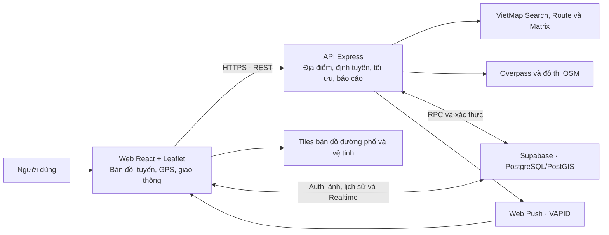

# iMap — Dẫn đường, tối ưu hành trình và cảnh báo giao thông cộng đồng

**Đề tài** · A Web-Based Navigation and Route Optimization System with Real-Time Community Traffic Updates

[Web production](https://i-map-zzzf.vercel.app/) · [API health](https://i-map-one.vercel.app/api/health) · [Tài liệu API](#api-rest) · [GitHub Issues](https://github.com/dpm14092006-UIT/iMap/issues)

## Giới thiệu

iMap giúp người đi ô tô và xe máy tìm và so sánh tuyến, sắp xếp điểm ghé, dẫn đường bằng GPS và nhận cảnh báo sự cố trên đường đi. Theo báo cáo công tác 9 tháng đầu năm 2025 của Sở Xây dựng TP.HCM, thành phố còn 24 điểm có nguy cơ ùn tắc. [Cổng Thông tin điện tử Chính phủ tại TP.HCM](https://tphcm.baochinhphu.vn/tphcm-sap-khoi-cong-khanh-thanh-loat-du-an-ha-tang-trong-diem-101251025123641522.htm)

Khảo sát Google Routes API và Waze cho thấy hai hướng giải quyết là tối ưu thứ tự điểm dừng và tiếp nhận báo cáo tại chỗ. iMap kết nối hai hướng này vào một chuyến đi. Trước chuyến đi, người dùng chọn phương án và thứ tự ghé dựa trên chi phí đường bộ. Trong chuyến đi, vị trí và phạm vi phương tiện của sự cố giúp xác định khi nào cần cảnh báo và xem tuyến tránh. [Google Routes API](https://developers.google.com/maps/documentation/routes/opt-way) · [Waze Help](https://support.google.com/waze/answer/13740207)

## Tính năng trên web

| Tính năng | Cách sử dụng |
| --- | --- |
| Bản đồ và tìm địa điểm | Xem bản đồ đường phố hoặc vệ tinh, tìm theo tên, đường và địa chỉ. Chọn điểm trên bản đồ, định vị và tìm địa điểm quanh đây hoặc dọc tuyến. |
| Chỉ đường và so sánh | Chọn điểm đi, điểm đến, ô tô hoặc xe máy. Xem tuyến và chỉ dẫn rẽ từ VietMap, đối chiếu thời gian, quãng đường và số lần rẽ khi có dữ liệu. Có thể sao chép liên kết tuyến. |
| Tối ưu nhiều điểm | Giữ điểm xuất phát, tự sắp xếp tối đa 15 điểm ghé theo thời gian hoặc quãng đường. Chọn đi một chiều hoặc quay lại điểm xuất phát. |
| Dẫn đường và lưu tuyến | Bắt đầu chuyến để xem tiến độ GPS và nghe chỉ dẫn. Khi có sự cố trên tuyến, xem cảnh báo và phương án đi vòng nếu tìm được. Lưu và mở lại hành trình trên trình duyệt đang dùng. |
| Trợ lý địa điểm | Thành viên chọn danh mục hoặc nhập nhu cầu bằng chữ để tìm quanh vị trí hay dọc tuyến và chọn điểm ghé. |
| Giao thông cộng đồng | Xem sự cố trên bản đồ. Thành viên có thể báo sự cố, đính kèm ảnh và xác nhận đường đã thông hay sự cố vẫn còn. |
| Tài khoản và Web Push | Thành viên đăng nhập để dùng các tính năng cá nhân và lịch sử điểm đi, điểm đến. Web Push cảnh báo trên tuyến đang theo dõi khi người dùng cấp quyền và trình duyệt hỗ trợ. |

## Kiến trúc

- **Chọn tuyến.** Web lấy vị trí từ truy vấn địa chỉ hoặc bản đồ, gọi VietMap qua API và hiển thị hình học, ETA và chỉ dẫn. Backend tính chênh lệch và xếp hạng theo ưu tiên đã chọn.
- **Tối ưu điểm ghé.** API lấy ma trận chi phí có hướng từ VietMap. Held–Karp tìm thứ tự tối ưu trên ma trận, còn Nearest Neighbor + 2-opt phục vụ chế độ nhanh. API gọi Route để vẽ tuyến theo thứ tự đã chọn.
- **Cảnh báo sự cố.** API lưu báo cáo có tọa độ, phạm vi xe và thời hạn. Realtime cập nhật lớp giao thông. Khi sự cố gần tuyến đang theo dõi, iMap có thể gửi Web Push và tìm đường tránh.

## Dữ liệu

| Dữ liệu vận hành | Cách lưu |
| --- | --- |
| Báo cáo và xác nhận | `traffic_reports` lưu vị trí PostGIS, loại, mức độ, phương tiện, trạng thái và thời hạn. `report_updates` liên kết báo cáo với xác nhận của thành viên. |
| Ảnh báo cáo | Bucket riêng tư `traffic-images`. Báo cáo giữ đường dẫn tệp, truy cập ảnh qua liên kết có thời hạn theo quyền. |
| Lịch sử tìm tuyến | `recent_places` lưu điểm đi và điểm đến theo tài khoản. |
| Cảnh báo đẩy | `push_subscriptions` lưu đăng ký trình duyệt. `route_watches` liên kết đăng ký với tuyến và thời hạn theo dõi. |
| Tài khoản và hạn mức | Supabase Auth quản lý tài khoản. PostgreSQL áp dụng quyền theo người dùng và theo dõi hạn mức trợ lý ở `user_feature_usage_by_minute`. |

PostGIS hỗ trợ truy vấn báo cáo theo vùng và tìm tuyến ở gần sự cố. Supabase Realtime cập nhật báo cáo trên bản đồ. Cơ chế RLS giới hạn truy cập dữ liệu cá nhân và ảnh.

## Công nghệ và triển khai

| Thành phần | Công nghệ và môi trường |
| --- | --- |
| Web | React, TypeScript, Vite, Tailwind CSS, Leaflet và API trình duyệt cho GPS, âm thanh và chia sẻ. [Vercel Web](https://i-map-zzzf.vercel.app/) |
| API REST | Node.js, Express, TypeScript, Zod và Web Push/VAPID. [Vercel API](https://i-map-one.vercel.app/api/health) |
| Cơ sở dữ liệu | Supabase Auth, PostgreSQL, PostGIS, RLS, Storage và Realtime. |
| Dữ liệu bản đồ | VietMap cho bản đồ nền, tìm kiếm, định tuyến và ma trận. Esri cho địa hình và nền dự phòng. OpenStreetMap và Overpass cung cấp dữ liệu cho các tính năng liên quan. |
| Triển khai | Web và API là hai project Vercel cùng lấy mã từ `main`. GitHub Actions kiểm tra kiểu, test và build. [GitHub Actions](https://github.com/dpm14092006-UIT/iMap/actions) |

## API REST

Base URL là `https://i-map-one.vercel.app/api`. API trả JSON, dùng tọa độ `{lat, lng}` và tính khoảng cách, thời lượng bằng mét, giây. Các thao tác dành cho thành viên yêu cầu access token Supabase.

| Method và path | Công dụng |
| --- | --- |
| `GET /health`, `GET /push/config` | Kiểm tra API và Web Push. |
| `GET /places/suggest`, `GET /places/details`, `GET /places/reverse` | Gợi ý địa chỉ, đọc chi tiết và tra địa chỉ từ tọa độ. |
| `GET /places/nearby`, `POST /places/along-route` | Tìm địa điểm quanh vị trí hoặc dọc tuyến. |
| `POST /routes/calculate`, `POST /routes/compare`, `POST /routes/reroute` | Tính tuyến, so sánh và tính lại tuyến. |
| `POST /routes/optimize` | Sắp xếp thứ tự ghé theo chi phí VietMap Matrix. |
| `GET /routes/algorithm/graph`, `POST /routes/algorithm` | Đọc vùng phủ OSM trung tâm TP.HCM và chạy Dijkstra/A*. |
| `GET /traffic-reports`, `GET /traffic-reports/geojson` | Đọc báo cáo theo bounding box `minLat`, `minLng`, `maxLat`, `maxLng`. |
| `POST /traffic-reports`, `POST /traffic-reports/:id/clearance` | Gửi và xác nhận báo cáo. |
| `POST /route-stops/search`, `POST /route-stops/explore` | Tìm điểm ghé theo nhu cầu của thành viên. |

[Health trực tuyến](https://i-map-one.vercel.app/api/health) · [Web Push config](https://i-map-one.vercel.app/api/push/config) · [Thông tin đồ thị OSM](https://i-map-one.vercel.app/api/routes/algorithm/graph)

## Kết quả trên production

| Kiểm tra ngày 24/11/2026 | Kết quả |
| --- | --- |
| Tìm và so sánh tuyến | Web trả ba phương án cho tuyến Chợ Bến Thành → Dinh Độc Lập. API tính tuyến và so sánh đều trả HTTP 200. |
| Tối ưu nhiều điểm | Ca kiểm tra ba điểm trả HTTP 200 và đổi thứ tự ghé từ `0 → 1 → 2` thành `0 → 2 → 1`. |
| Dijkstra và A* | Đồ thị online có 17.368 nút và 31.929 cạnh có hướng. Trong một ca cùng điểm đầu và cuối, cả hai trả 1.114 m. A* duyệt 349 nút so với 2.065 nút của Dijkstra. |
| Báo cáo và cảnh báo | API báo cáo trả HTTP 200. API Web Push trả `enabled: true`. |

Kết quả cho thấy người dùng có thể tìm tuyến, so sánh phương án và tối ưu thứ tự ghé trên bản web đang triển khai. Ca so sánh Dijkstra/A* minh họa hiệu quả của heuristic trên đồ thị hiện có. [Mã nguồn iMap](https://github.com/dpm14092006-UIT/iMap)

## Nguồn tham khảo

- [VietMap Route v4](https://maps.vietmap.vn/docs/map-api/route-version/route-v4/) · [OpenStreetMap](https://www.openstreetmap.org/copyright) · [Leaflet](https://leafletjs.com/)
- [PostGIS](https://postgis.net/docs/) · [Supabase Realtime](https://supabase.com/docs/guides/realtime) · [Vercel Express](https://vercel.com/docs/frameworks/backend/express)
- [Dijkstra](https://doi.org/10.1007/BF01386390) · [A*](https://doi.org/10.1109/TSSC.1968.300136) · [Held–Karp](https://doi.org/10.1137/0110015)
