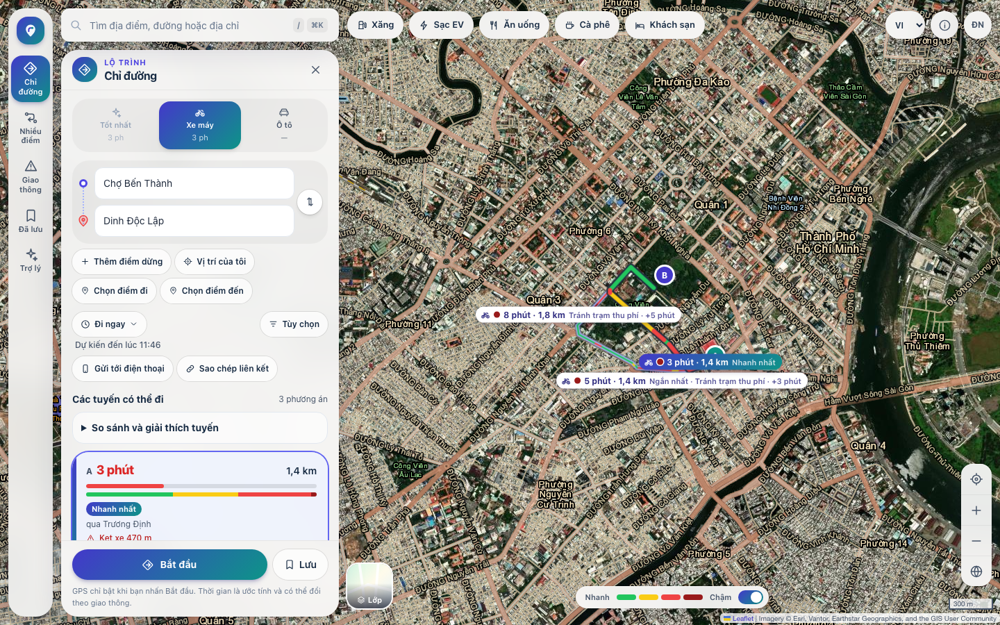
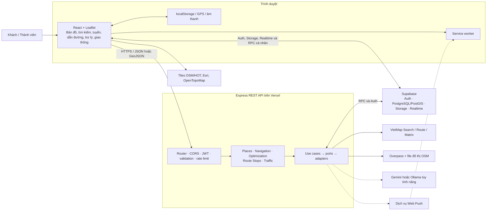
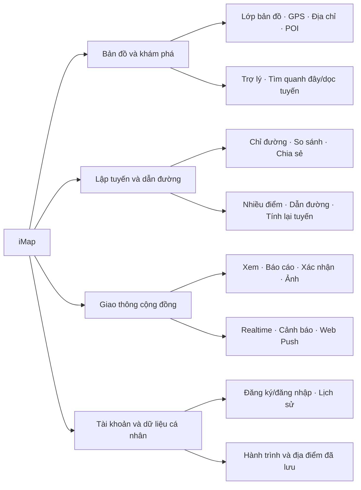
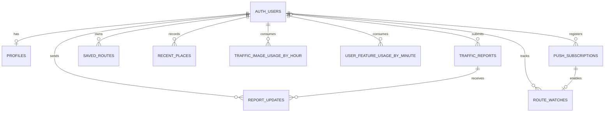

# iMap — Dẫn đường, tối ưu hành trình và cảnh báo giao thông cộng đồng

**Đề tài** · A Web-Based Navigation and Route Optimization System with Real-Time Community Traffic Updates



[Web demo](https://i-map-zzzf.vercel.app/) · [API health](https://i-map-one.vercel.app/api/health) · [Tài liệu API](docs/architecture/API_CONTRACTS.md) · [Issues](https://github.com/dpm14092006-UIT/iMap/issues)

## Lời cảm ơn

Nhóm iMap cảm ơn giảng viên và các bạn đã góp ý cho đồ án, cùng cộng đồng OpenStreetMap và các dịch vụ bản đồ, định tuyến đã cung cấp dữ liệu và công cụ cho dự án.

## Tóm tắt

iMap là ứng dụng web cho ô tô và xe máy. Người dùng tìm địa điểm, so sánh các tuyến, sắp xếp thứ tự ghé nhiều điểm và theo dõi chỉ dẫn trong chuyến đi. Báo cáo cộng đồng có vị trí, thời hạn, mức độ, phạm vi phương tiện và xác nhận tình trạng đường. Hệ thống kết hợp VietMap cho tuyến đường thực tế, OSM cho thử nghiệm thuật toán và Supabase/PostGIS cho dữ liệu cộng đồng. Trong benchmark cục bộ trên đồ thị OSM trung tâm TP.HCM, A* giữ nguyên chi phí của Dijkstra ở 800 lượt so sánh và giảm 52–75% số nút được duyệt trung bình tùy cấu hình.

## Mục lục

1. [Giới thiệu và khảo sát](#giới-thiệu-và-khảo-sát)
2. [Tính năng hệ thống](#tính-năng-hệ-thống)
3. [Kiến trúc và luồng xử lý](#kiến-trúc-và-luồng-xử-lý)
4. [Thiết kế cơ sở dữ liệu](#thiết-kế-cơ-sở-dữ-liệu)
5. [Công nghệ và triển khai](#công-nghệ-và-triển-khai)
6. [API REST](#api-rest)
7. [Điểm nổi bật và kết quả](#điểm-nổi-bật-và-kết-quả)
8. [Checklist bảo vệ và hỏi đáp](#checklist-bảo-vệ-và-hỏi-đáp)
9. [Tài liệu tham khảo](#tài-liệu-tham-khảo)

## Giới thiệu và khảo sát

**Bối cảnh và vấn đề.** Theo báo cáo công tác 9 tháng đầu năm 2025 của Sở Xây dựng TP.HCM, thành phố còn **24 điểm có nguy cơ ùn tắc giao thông**. Khi lập kế hoạch đi qua nhiều địa điểm, người dùng phải quyết định cả thứ tự ghé lẫn tuyến đường. Trong lúc di chuyển, một sự cố mới có thể làm thay đổi lựa chọn ban đầu. [Cổng Thông tin điện tử Chính phủ tại TP.HCM](https://tphcm.baochinhphu.vn/tphcm-sap-khoi-cong-khanh-thanh-loat-du-an-ha-tang-trong-diem-101251025123641522.htm)

| Hướng khảo sát | Kết quả có thể sử dụng | Quyết định thiết kế ở iMap |
| --- | --- | --- |
| Nền tảng định tuyến | VietMap cung cấp tuyến và chỉ dẫn rẽ. Google Routes API có tính năng tối ưu thứ tự điểm dừng. | Dùng VietMap Route và Matrix, tự cài đặt thuật toán để kiểm tra chi phí tối ưu và đối chiếu với heuristic. [VietMap Route v4](https://maps.vietmap.vn/docs/map-api/route-version/route-v4/) · [Google Routes API](https://developers.google.com/maps/documentation/routes/opt-way) |
| Báo cáo cộng đồng | Waze tiếp nhận báo cáo giao thông từ người dùng và hạn chế tần suất gửi. | Lưu từng báo cáo, theo dõi thời hạn, phạm vi phương tiện và xác nhận. Dùng vị trí để đối chiếu với tuyến đang đi. [Waze Help](https://support.google.com/waze/answer/13740207) |
| Thuật toán đồ thị và tối ưu | Dijkstra là mốc đối chiếu cho A*. Held–Karp dùng quy hoạch động để tìm thứ tự tối ưu trong bài toán nhiều điểm. | Đo số nút duyệt, thời gian và độ lệch chi phí so với lời giải chính xác. [Dijkstra](https://doi.org/10.1007/BF01386390) · [Hart và cộng sự](https://doi.org/10.1109/TSSC.1968.300136) · [Held & Karp](https://doi.org/10.1137/0110015) |

**Khoảng trống của đề tài.** Từ khảo sát, nhóm chọn kiểm chứng cách kết nối ba quyết định trong cùng một chuyến đi: chọn tuyến theo ưu tiên, sắp xếp điểm ghé theo chi phí đường bộ và phản ứng khi có báo cáo mới phù hợp với phương tiện. Với từng quyết định, iMap có dữ kiện để giải thích kết quả, gồm chênh lệch ETA/quãng đường/số lần rẽ, chi phí ma trận và thời điểm/phạm vi báo cáo.

**Mục tiêu và phương pháp.** Xây dựng web điều hướng có API REST và dữ liệu không gian. Tích hợp VietMap để lấy dữ liệu tuyến, tổ chức nghiệp vụ theo Clean Architecture, dùng PostGIS và Realtime cho báo cáo, rồi đánh giá qua benchmark thuật toán và các hành trình mẫu. Giới hạn thử nghiệm và các trạng thái triển khai được ghi ở phần kết quả.

## Tính năng hệ thống

| Nhóm | Chức năng trong mã nguồn | Quyền và điều kiện |
| --- | --- | --- |
| Bản đồ và giao diện | Khung nhìn Việt Nam, thu phóng, định vị, chọn điểm trên bản đồ và quay về toàn quốc. Nền đường phố/vệ tinh, địa hình, lớp sự cố và lớp giao thông. UI responsive, tiếng Việt và tiếng Anh. | Khách. Định vị cần thiết bị/trình duyệt cấp quyền. |
| Tìm địa chỉ | Gợi ý tên, địa chỉ và tên đường theo tâm bản đồ, chỉ lấy tọa độ khi chọn gợi ý. Reverse geocoding, lọc loại tìm kiếm, lịch sử điểm đi/đến và thao tác xóa lịch sử. | Tìm kiếm cho khách. Lịch sử điểm đi/đến đồng bộ khi có tài khoản. |
| Khám phá địa điểm | Tìm quanh tâm hoặc dọc tuyến theo từ khóa/danh mục, lọc và xem danh sách/thẻ/điểm trên bản đồ. Có khoảng cách, vị trí dọc tuyến, ước lượng đi vòng, lưu địa điểm và thao tác với điểm ghé. | Khách. POI VietMap và ước lượng hình học. |
| Chỉ đường | Chọn điểm đi/đến, vị trí hiện tại hoặc điểm trên bản đồ. Xe máy/ô tô, tối đa 8 điểm dừng thủ công, đổi thứ tự, chọn tiêu chí và tùy chọn tránh phà/phí theo phản hồi VietMap. Hiển thị hình học, ETA, quãng đường, chỉ dẫn từng chặng và thông tin phí/giao thông khi có dữ liệu. | Khách. VietMap Route v4. |
| So sánh tuyến | Hiện các phương án hợp lệ, chênh lệch thời gian, khoảng cách và số lần rẽ khi có. Chọn nhanh nhất, ngắn nhất, ít rẽ hoặc mô tả ưu tiên bằng câu. Xác nhận phương án trên bản đồ và chia sẻ qua link/Web Share. | Khách dùng preset/rules. Phân tích câu bằng model cần tài khoản, cấu hình và quota. |
| Dẫn đường | Bắt đầu/dừng chuyến, đọc GPS, tốc độ, chỉ dẫn tiếp theo, tiến độ/quãng đường còn lại, theo dõi lệch tuyến, cập nhật khi đến nơi. Phát lời chỉ dẫn và chuông. Cảnh báo sự cố phù hợp phía trước, đề xuất tuyến tránh hoặc hiển thị tình trạng khi thiếu phương án. | Khách. GPS và âm thanh phụ thuộc trình duyệt/thiết bị. |
| Nhiều điểm | Cố định điểm xuất phát, tối đa 15 điểm ghé. Chọn thời gian/quãng đường, ô tô/xe máy, hành trình mở hoặc quay về, Tự động/Chính xác/Nhanh. So sánh thứ tự nhập và thứ tự tối ưu, giữ bản nháp khi đóng bảng, lưu hoặc xóa hành trình. | Khách. VietMap Matrix và Route. |
| Tuyến đã lưu | Lưu tuyến chỉ đường và nhiều điểm, mở lại và tính tuyến mới từ các điểm đã lưu, xóa tuyến trên trình duyệt. | Khách. Dữ liệu trong `localStorage`. |
| Trợ lý địa điểm | Chọn danh mục/thao tác hoặc nhập nhu cầu bằng chữ, hỏi lại khi mơ hồ. Tìm quanh vị trí hoặc dọc tuyến, lọc theo nhu cầu và thêm/bỏ điểm ghé. Với tuyến, lấy ứng viên từ Overpass và có thể dùng VietMap để đánh giá đi vòng. | Thành viên. Bộ luật từ khóa hoạt động khi không có model. |
| Báo cáo giao thông | Danh sách, lớp bản đồ và GeoJSON theo vùng. Sáu loại: kẹt xe, tai nạn, công trình, ngập, đóng đường, chướng ngại vật. Có mức độ, xe áp dụng, ghi chú, ảnh tùy chọn, xác nhận còn/chấm dứt sự cố, số lượt/người báo gần đó và hết hạn tự động theo TTL. | Khách xem dữ liệu công khai. Thành viên gửi, xác nhận và đọc ảnh hợp lệ. |
| AI ảnh giao thông | Phân tích ảnh hiện trường hoặc biển báo, điền gợi ý để người dùng kiểm tra trước khi gửi. | Thành viên, cần bật Gemini. |
| Tài khoản, thông báo | Đăng ký/đăng nhập email và mật khẩu, khôi phục phiên, đăng xuất. Realtime và cảnh báo trong trang. Web Push tùy chọn gồm xin quyền, đăng ký trình duyệt, theo dõi tuyến và nhận thông báo từ service worker. | Web Push cần tài khoản, trình duyệt hỗ trợ, sự đồng ý và cấu hình server. |
| Thuật toán OSM | API trả vùng phủ/kích thước graph, chạy Dijkstra và A* theo thời gian hoặc quãng đường trên graph có hướng, xét loại xe và snap điểm vào mạng đường. | Mã và dữ liệu benchmark có trong repo. Phạm vi trung tâm TP.HCM. |

## Kiến trúc và luồng xử lý

### Kiến trúc tổng thể



Frontend tổ chức theo feature, dùng hooks và `app/flows` để điều phối. Backend đi theo **router → controller → use case → port → adapter**. Domain chứa giá trị và thuật toán, các adapter kết nối VietMap, Supabase, OSM và AI. `compositionRoot.ts` tạo dependencies. `packages/shared` giữ kiểu TypeScript và schema Zod chung. [Kiến trúc chi tiết](docs/architecture/ARCHITECTURE.md) · [Cây thư mục](docs/architecture/FOLDER_TREE.md)

### Sơ đồ nhóm chức năng



### Ba luồng chính

```mermaid
flowchart TD
    subgraph L1["1. Tìm tuyến và lựa chọn"]
      A1["Điểm đi/đến + xe + ưu tiên"] --> A2["Autocomplete → Place → Route v4"]
      A2 --> A3["Hình học + chỉ dẫn + các phương án"]
      A3 --> A4["Snapshot ký → so sánh số liệu → người dùng chọn"]
      A4 --> A5["Vẽ tuyến, chia sẻ hoặc dẫn đường bằng GPS"]
    end
    subgraph L2["2. Tối ưu hành trình"]
      B1["Điểm xuất phát + danh sách ghé + tiêu chí"] --> B2["Matrix VietMap có hướng"]
      B2 --> B3["Held–Karp hoặc Nearest Neighbor + 2-opt"]
      B3 --> B4["Route v4 theo thứ tự đã chọn → bản đồ + tổng chi phí"]
    end
    subgraph L3["3. Báo cáo và phản ứng trên tuyến"]
      C1["Thành viên gửi vị trí, loại sự cố và ảnh tùy chọn"] --> C2["Xác thực → RPC PostGIS → báo cáo có thời hạn"]
      C2 --> C3["Realtime/BBox → lớp bản đồ và đối chiếu GPS/tuyến"]
      C3 --> C4["Banner/âm thanh → xét tuyến tránh qua VietMap"]
      C2 -.-> C5["Nếu Web Push bật: tìm route watch → push → service worker"]
    end
```



Trong luồng 3, xác nhận cộng đồng cập nhật trạng thái và phiên bản báo cáo. Khi đang dẫn đường, sự cố phù hợp ở phía trước có thể kích hoạt tính phương án tránh. Backend thử phương án tuyến thay thế hoặc tạo điểm đi vòng theo hình học. Mức ảnh hưởng được ước lượng bằng khoảng cách tới tuyến và phạm vi phương tiện.

## Thiết kế cơ sở dữ liệu

Schema dưới đây đối chiếu các migration `0001–0009`. `auth.users` và bảng Storage do Supabase quản lý. Ứng dụng có **9 bảng trong schema `public`**.



| Bảng | Khóa và cột | Truy cập / mục đích |
| --- | --- | --- |
| `profiles` | `id` UUID PK/FK → `auth.users.id`, `preferred_vehicle` text, `created_at` timestamptz | Trigger lúc tạo tài khoản. RLS đọc/cập nhật hồ sơ của mình. |
| `traffic_reports` | `id` UUID PK, `user_id` UUID FK nullable, `incident_type`, `severity`, `vehicle_scope`, `status`, `note`, `image_path` text, `geom` geography(Point,4326), `gps_accuracy_m` và `heading_deg` double, `version` int, `created_at`, `expires_at` timestamptz | Báo cáo không gian, đọc/ghi qua RPC. `status` là active/cleared/expired. `vehicle_scope` là car/motorcycle/both. GiST trên `geom`, chỉ mục theo thời gian/trạng thái/người gửi và loại/phạm vi. |
| `report_updates` | `id` UUID PK, `report_id` UUID FK, `user_id` UUID FK, `state` text, `created_at` timestamptz | Lịch sử `clear` hoặc `still_active`. Chỉ mục báo cáo, người dùng, thời điểm cho cooldown. Báo cáo bị xóa thì cập nhật con cascade. |
| `saved_routes` | `id` UUID PK, `user_id` UUID FK, `title`, `vehicle` text, `waypoints` JSONB, `created_at` timestamptz | Schema và RLS CRUD theo chủ sở hữu đã có. Web đang lưu tuyến trên trình duyệt, route server trả 501. |
| `recent_places` | `id` UUID PK, `user_id` UUID FK, `kind`, `place_key`, `name`, `address`, `category`, `source` text, `lat`, `lng` double, `used_at` timestamptz. Unique `(user_id, kind, place_key)`. | Điểm đi/đến, tối đa 10 mục mỗi loại/người. Ghi qua RPC, đọc/xóa theo chủ sở hữu. |
| `traffic_image_usage_by_hour` | PK `(user_id, period_start)`, `user_id` UUID FK, `period_start` timestamptz, `request_count` int | Quota AI ảnh, 10 lượt/giờ/tài khoản. Tăng nguyên tử trong DB. |
| `user_feature_usage_by_minute` | PK `(user_id, feature, period_start)`, `user_id` UUID FK, `feature` text, `period_start` timestamptz, `request_count` int | 5 lượt/phút/tài khoản cho từng tính năng cần quota. `route_stops` và `route_explanation` đang có người gọi. `voice` là giá trị tương thích schema cũ. |
| `push_subscriptions` | `endpoint` text PK, `user_id` UUID FK, `p256dh`, `auth` text, `created_at`, `updated_at` timestamptz | Đăng ký push qua RPC. Đọc/xóa theo chủ sở hữu. Migration 0009 giới hạn nhà cung cấp endpoint được chấp nhận. |
| `route_watches` | `endpoint` text PK/FK → `push_subscriptions.endpoint`, `user_id` UUID FK, `vehicle` text, `path` geography(LineString,4326), `location` geography(Point,4326) nullable, `updated_at`, `expires_at` timestamptz | Một lượt theo dõi hiện hành mỗi subscription, TTL 20 phút khi ngừng gia hạn. GiST theo đường đi, chỉ mục TTL. Subscription xóa thì watch cascade. |

- **RPC và trạng thái.** `get_traffic_reports_bbox` trả tối đa 200 báo cáo còn hạn và tổng hợp báo cáo cùng loại, phạm vi xe tương thích trong 75 m/30 phút. `create_traffic_report` và `update_traffic_report_clearance` ghi sự cố/xác nhận với quyền thành viên. TTL 12 giờ cho tai nạn/đóng đường, 4 giờ cho loại khác. `expire_stale_traffic_reports` cập nhật trạng thái và dọn dữ liệu quota cũ. Cron mẫu chạy mỗi phút.
- **Storage và Realtime.** Bucket riêng tư `traffic-images` nhận JPEG/PNG/WebP tối đa 5 MB. `image_path` tham chiếu tên object, quyền ghi theo thư mục người dùng, quyền đọc ảnh hợp lệ qua session và signed URL. Trigger broadcast báo cáo đến client, `version` dùng để theo dõi thứ tự cập nhật.
- **Dữ liệu cá nhân và push.** `record_recent_place`, `save_push_subscription` và `upsert_route_watch` ghi dữ liệu trong ngữ cảnh người dùng. API server dùng `find_route_watchers` và `delete_push_subscription` với quyền dịch vụ. Quota ảnh và trợ lý đi qua hai RPC quota độc lập với bộ đếm IP trong Express. Migration 0003 đã xóa các bảng AI thử nghiệm `ai_analyses` và `ai_usage_by_hour`.

[SQL migrations](supabase/migrations/) · [Vận hành Supabase](supabase/README.md) · [SQL job hết hạn](supabase/ops/traffic-expiry-cron.sql)

## Công nghệ và triển khai

| Lớp | Công nghệ |
| --- | --- |
| Frontend | TypeScript, React 19, Vite 6, Tailwind CSS 3, CSS, PostCSS/Autoprefixer, Leaflet 1.9, GeoJSON. Supabase JS cho phiên, lịch sử, Realtime và Storage. |
| Trình duyệt | Geolocation, localStorage, Clipboard/Web Share, SpeechSynthesis, Web Audio, Notifications, Push API, Service Worker và Cache Storage. |
| Backend | Node.js, TypeScript, Express 5, REST/JSON, Zod, CORS, dotenv, Supabase JS, `web-push` và VAPID. |
| Dữ liệu | PostgreSQL, SQL/PLpgSQL, PostGIS, GiST, Supabase Auth, JWT, RLS, Storage, Realtime, PostgREST RPC, pg_cron theo cấu hình. |
| Bản đồ và đích đến | OSM/HOT, Esri và OpenTopoMap cho bản đồ. VietMap Autocomplete/Place/Search/Reverse, Route v4 và Matrix cho dữ liệu đường bộ và địa điểm. Overpass cho POI OSM và xuất graph. |
| AI tùy cấu hình | Vercel AI SDK `ai` và `@ai-sdk/google`, Gemini cho ảnh và/hoặc đọc ý định. Ollama là lựa chọn chạy model văn bản cục bộ. Có parser dựa trên từ khóa. |
| Thuật toán | Đồ thị có hướng OSM, thành phần liên thông mạnh, min-heap, Dijkstra, A* với heuristic khoảng cách hoặc thời gian. Held–Karp, Nearest Neighbor và 2-opt cho thứ tự ghé. Phép chiếu vị trí lên tuyến cho dẫn đường và khoảng cách POI/sự cố. |
| Phát triển, QA | npm workspaces, tsc, tsx, concurrently, ESLint, Prettier, Vitest, Testing Library/jsdom, Playwright/Chromium, Git/GitHub Actions, Dockerfile API và Supabase CLI. Python/faster-whisper có trong công cụ benchmark lịch sử. |

### Môi trường production

| Thành phần | Thiết lập đã kiểm tra |
| --- | --- |
| Web | Vercel project `i-map-zzzf`, root `apps/web`, preset Vite, Node 26.x, output `dist`. Cài từ root monorepo, build shared trước web. `VITE_API_BASE_URL` trỏ tới API HTTPS có hậu tố `/api`. [Web production](https://i-map-zzzf.vercel.app/) |
| API | Vercel project `i-map`, root `apps/api`, preset Express, Node 26.x, build shared, entry `src/app.ts`, cấu hình timeout 60 giây và đính kèm file đồ thị OSM trong Vercel Function. Hai project lấy nhánh `main`. [API health](https://i-map-one.vercel.app/api/health) |
| Database | Supabase Cloud. API đọc được báo cáo theo bounding box. Schema đích quản lý bằng migration; lịch chạy job hết hạn cấu hình riêng trong Supabase. [Hướng dẫn database](supabase/README.md) |
| Cấu hình | Web cần `VITE_SUPABASE_URL`, `VITE_SUPABASE_PUBLISHABLE_KEY`. API cần `CORS_ORIGIN`, `SUPABASE_URL`, `SUPABASE_PUBLISHABLE_KEY`, `VIETMAP_API_KEY`. Push cần thêm `SUPABASE_SECRET_KEY`, `WEB_PUSH_PUBLIC_KEY`, `WEB_PUSH_PRIVATE_KEY` và cấu hình VAPID subject. Gemini cần khóa và cờ/provider tương ứng. [Hướng dẫn triển khai](docs/guides/DEPLOY_API.md) |

**Kiểm tra production ngày 24/11/2026.** Web đã tìm địa chỉ và tính được ba phương án Chợ Bến Thành → Dinh Độc Lập. Tính tuyến, so sánh, tối ưu nhiều điểm, đọc báo cáo và chạy Dijkstra/A* đều trả HTTP 200. Đồ thị production có 17.368 nút, 31.929 cạnh. Web Push đã bật ở API bằng cấu hình VAPID Production. Người dùng vẫn cần đăng nhập, cấp quyền và có chuyến đi được theo dõi để nhận thông báo. AI ảnh đang tắt ở production. [PR sửa entrypoint Express và Web Push sau đăng xuất](https://github.com/dpm14092006-UIT/iMap/pull/20) · [Health](https://i-map-one.vercel.app/api/health) · [Graph](https://i-map-one.vercel.app/api/routes/algorithm/graph) · [Web Push config](https://i-map-one.vercel.app/api/push/config)

### Chạy và kiểm tra local

```bash
git clone https://github.com/dpm14092006-UIT/iMap.git
cd iMap
npm ci
cp apps/api/.env.example apps/api/.env
cp apps/web/.env.example apps/web/.env
npm run dev
```

Điền cấu hình theo hai file mẫu, dùng Node theo `.nvmrc` và áp dụng migration theo thứ tự `0001–0009` nếu dùng Supabase mới. Web local ở `http://localhost:5173`, API ở `http://localhost:4000/api/health`. Dùng `npm run format:check`, `npm run lint`, `npm run typecheck`, `npm test`, `npm run build` và `npm run test:browser` để đối chiếu với CI. [Setup local](docs/guides/SETUP_MAC.md) · [Workflow CI](.github/workflows/ci.yml)

## API REST

Base URL production là `https://i-map-one.vercel.app/api`. Các path bên dưới tính từ base URL. Hợp đồng được công bố trên GitHub và kiểu dữ liệu/validation nằm trong `packages/shared`. [Kiểm tra API health](https://i-map-one.vercel.app/api/health)

| Method và path | Công dụng / quyền |
| --- | --- |
| `GET /health`, `GET /push/config` | Trạng thái API và cấu hình push công khai. |
| `GET /places/suggest`, `GET /places/details`, `GET /places/reverse` | Autocomplete, tra chi tiết theo ID và tọa độ → địa chỉ. |
| `GET /places/nearby`, `POST /places/along-route` | Tìm POI quanh tâm hoặc theo hành lang dọc tuyến. |
| `POST /routes/calculate`, `POST /routes/compare` | Lấy tuyến VietMap và so sánh phương án từ snapshot ký. Model đọc ưu tiên cần thành viên. |
| `POST /routes/reroute`, `POST /routes/optimize` | Tính tuyến mới và tối ưu thứ tự điểm ghé bằng Matrix. |
| `POST /routes/algorithm`, `GET /routes/algorithm/graph` | Thử Dijkstra/A* và đọc vùng phủ đồ thị OSM. |
| `GET /route-stops/config`, `POST /route-stops/search`, `POST /route-stops/explore` | Trạng thái/các thao tác trợ lý địa điểm. Cần thành viên. |
| `GET /traffic-reports`, `GET /traffic-reports/geojson` | Báo cáo theo bounding box và GeoJSON cho bản đồ. |
| `POST /traffic-reports`, `POST /traffic-reports/:id/clearance` | Gửi báo cáo hoặc xác nhận tình trạng. Cần thành viên. |
| `POST /traffic-reports/analyze-image` | Gợi ý từ ảnh với `task=incident` hoặc `task=traffic_sign`. Cần thành viên và Gemini được bật. |
| `GET /my-routes` | HTTP 501. Lưu tuyến hiện qua trình duyệt. |

API dùng `{ data }` cho kết quả JSON thông thường, `{ error: { code, message, requestId } }` cho lỗi và `X-Request-Id` cho đối chiếu log. Tọa độ JSON dạng `{lat,lng}`, GeoJSON dùng `[lng,lat]`. API nội bộ trao đổi mét/giây, web đổi sang đơn vị hiển thị. [Hợp đồng API trực tuyến](https://github.com/dpm14092006-UIT/iMap/blob/main/docs/architecture/API_CONTRACTS.md) · [Kiểu dữ liệu dùng chung](packages/shared/src/)

## Điểm nổi bật và kết quả

**Highlight cho demo.** Mở một tuyến có nhiều phương án, chọn ưu tiên và giải thích chênh lệch ETA/quãng đường trên dữ liệu thật. Sau đó mở tab **Nhiều điểm** để minh họa thứ tự ghé tối ưu. Với demo giao thông, dùng báo cáo có phạm vi tương ứng để minh họa việc iMap nhận sự cố và tìm tuyến tránh.

| Bài kiểm tra | Kết quả | Phạm vi |
| --- | --- | --- |
| Dijkstra và A* | 17.368 nút, 31.929 cạnh có hướng. 200 cặp × 4 cấu hình, 0 lần khác chi phí. A* giảm 52–75% số nút duyệt trung bình. Khoảng 0,91–1,85 ms so với 3,01–3,21 ms của Dijkstra. | Thời gian giải thuật tại máy đo trên graph OSM trung tâm TP.HCM, theo xe và tiêu chí. [Benchmark graph](docs/benchmarks/BENCHMARK_PATHFINDING.md) |
| Tối ưu nhiều điểm | Với 15 điểm ghé, Held–Karp 19,91 ms, NN + 2-opt 0,076 ms. NN + 2-opt cao hơn tối ưu trung bình 3,5%, đúng tối ưu 36% và sai lệch tối đa 24,5% trong cấu hình này. | 200 ma trận có hướng giả lập cho mỗi số điểm, hành trình mở. Số ms chỉ đo thứ tự ghé. [Benchmark TSP](docs/benchmarks/BENCHMARK_TSP.md) |
| Tuyến và ma trận thật | Ở một ca 4 điểm, chi phí giảm từ 22.952,79 m xuống 13.541,34 m, khoảng **41,0%** so với thứ tự nhập. | Một ca qua VietMap. Cần thêm nhiều hành trình để ước lượng hiệu quả điển hình. [Ca kiểm tra và dữ liệu](docs/benchmarks/SEARCH_VERIFICATION.md) |
| Tìm kiếm địa chỉ | Bộ đầu có 18 truy vấn, 17 truy vấn có gợi ý và tọa độ sau khi chọn, một chuỗi vô nghĩa trả rỗng. Sáu cặp tính tuyến mẫu đều trả 200. | Kiểm tra theo mẫu qua API VietMap; chưa đo precision/recall hay tọa độ lối vào ngoài thực địa. [Kết quả tìm kiếm](docs/benchmarks/SEARCH_VERIFICATION.md) |

**Kết luận.** Các thử nghiệm cho thấy A* giảm công việc tìm kiếm trên đồ thị đã đo và Held–Karp tìm thứ tự tối ưu trong giới hạn 15 điểm. Kết quả chỉ đường và cảnh báo còn phụ thuộc dữ liệu đường, mạng, chất lượng GPS và số lượng báo cáo. Đánh giá độ chính xác của Gemini, ETA thực tế, độ trễ p95 và hiệu quả cảnh báo trên nhiều chuyến đi vẫn cần bộ đo riêng.

## Checklist bảo vệ và hỏi đáp

**Đủ để trình bày:** kiến trúc FE–REST API–DB, kiểm tra web/API online, feature diagram, ERD đủ 9 bảng, ba luồng chính, công nghệ, cấu hình production, benchmark, tài liệu API online và danh sách Issues. Có [kế hoạch công việc WBS](docs/planning/WBS_N1.md), [backlog](docs/planning/IMPLEMENTATION_BACKLOG.md), [phân vai](docs/planning/OWNERSHIP.md) và [lịch triển khai](docs/planning/ROADMAP_2_WEEKS.md).

**Cần chốt cho buổi bảo vệ.** Tab Projects của repo hiện có 0 board được liên kết. [GitHub Projects](https://github.com/dpm14092006-UIT/iMap/projects) Nếu “API document online” yêu cầu Swagger/OpenAPI tương tác, repo đang dùng trang API Contracts trên GitHub. File PPT và tài liệu ngắn riêng là hai hiện vật nộp bài cần đối chiếu với yêu cầu môn học.

**Dàn ý 14 slide / 15 phút**, trong giới hạn 12–15 slide và tối đa 20. Phân bổ 2 phút mở đầu (slide 1–3), 3 phút bài toán/khảo sát (4–5), 4 phút thiết kế (6–9), 3 phút triển khai và demo (10–11), 2 phút kết quả (12), 1 phút hỏi đáp (13–14).

| Slide | Nội dung |
| --- | --- |
| 1 | Tên đề tài, ảnh bìa, nhóm thực hiện |
| 2 | Mục lục |
| 3 | Lời cảm ơn và abstract |
| 4 | Bối cảnh, số liệu TP.HCM và problem |
| 5 | Literature review, khoảng trống, mục tiêu và phương pháp |
| 6 | Kiến trúc tổng thể |
| 7 | Sơ đồ tính năng và quyền khách/thành viên |
| 8 | ERD, PostGIS, RLS, Storage/Realtime |
| 9 | Ba luồng từ đầu vào đến kết quả |
| 10 | Tech stack, API, database và production |
| 11 | Highlight, demo so sánh tuyến và nhiều điểm |
| 12 | Kết quả định lượng, giới hạn và kết luận |
| 13 | Hỏi đáp |
| 14 | Liên kết demo, repo, API docs và nguồn tham khảo |

<details>
<summary>Câu hỏi có thể gặp</summary>

- **Định tuyến online và Dijkstra/A* liên quan thế nào?** VietMap cung cấp tuyến web thông thường. Graph OSM là lớp thử nghiệm thuật toán trên mạng đường giới hạn.
- **Tối ưu 15 điểm có bảo đảm?** Held–Karp tối ưu trên ma trận và ràng buộc của bài toán. NN + 2-opt ưu tiên tốc độ. Chất lượng tuyến thực phụ thuộc chi phí đầu vào từ VietMap.
- **AI có tự chọn tuyến không?** Model chỉ hiểu câu ưu tiên hoặc đề xuất trường trong báo cáo ảnh. Backend tính chênh lệch theo dữ liệu có cấu trúc; người dùng chọn tuyến hoặc xác nhận báo cáo.
- **Báo cáo mới tác động thế nào?** API dùng PostGIS để truy vấn, Realtime cập nhật trình duyệt và ứng dụng xét sự cố theo vị trí/phương tiện. Sự cố gần tuyến được ước lượng bằng hình học.
- **Tuyến đã lưu có đồng bộ không?** Tuyến lưu trong trình duyệt. Tài khoản đồng bộ lịch sử điểm đi/đến qua Supabase.

</details>

## Tài liệu tham khảo

**Liên kết hệ thống**

- [GitHub repository](https://github.com/dpm14092006-UIT/iMap) · [Issues](https://github.com/dpm14092006-UIT/iMap/issues) · [Pull requests](https://github.com/dpm14092006-UIT/iMap/pulls) · [Actions](https://github.com/dpm14092006-UIT/iMap/actions)
- [Web production](https://i-map-zzzf.vercel.app/) · [API health](https://i-map-one.vercel.app/api/health) · [API contracts](https://github.com/dpm14092006-UIT/iMap/blob/main/docs/architecture/API_CONTRACTS.md)
- [Mục lục tài liệu dự án](docs/README.md) · [Quyền tính năng](docs/architecture/FEATURE_ACCESS.md) · [AI](docs/features/AI_APPLICATIONS.md) · [Trợ lý địa điểm](docs/features/PLACE_ASSISTANT_TECHNICAL.md) · [Checklist dẫn đường](docs/guides/NAVIGATION_CHECKLIST.md)

**Nguồn và công cụ**

- [Báo cáo bối cảnh giao thông TP.HCM](https://tphcm.baochinhphu.vn/tphcm-sap-khoi-cong-khanh-thanh-loat-du-an-ha-tang-trong-diem-101251025123641522.htm) · [Waze báo cáo giao thông](https://support.google.com/waze/answer/13740207) · [Google Routes API](https://developers.google.com/maps/documentation/routes/opt-way)
- [Dijkstra 1959](https://doi.org/10.1007/BF01386390) · [Hart, Nilsson & Raphael 1968](https://doi.org/10.1109/TSSC.1968.300136) · [Held & Karp 1962](https://doi.org/10.1137/0110015)
- [VietMap Route v4](https://maps.vietmap.vn/docs/map-api/route-version/route-v4/) · [VietMap Autocomplete v4](https://maps.vietmap.vn/docs/map-api/autocomplete-version/autocomplete-v4/) · [OpenStreetMap và giấy phép](https://www.openstreetmap.org/copyright) · [Overpass API](https://wiki.openstreetmap.org/wiki/Overpass_API) · [Leaflet](https://leafletjs.com/)
- [PostGIS](https://postgis.net/docs/) · [Supabase RLS](https://supabase.com/docs/guides/database/postgres/row-level-security) · [Supabase Realtime](https://supabase.com/docs/guides/realtime) · [Vercel Express](https://vercel.com/docs/frameworks/backend/express) · [Gemini API](https://ai.google.dev/gemini-api/docs)
