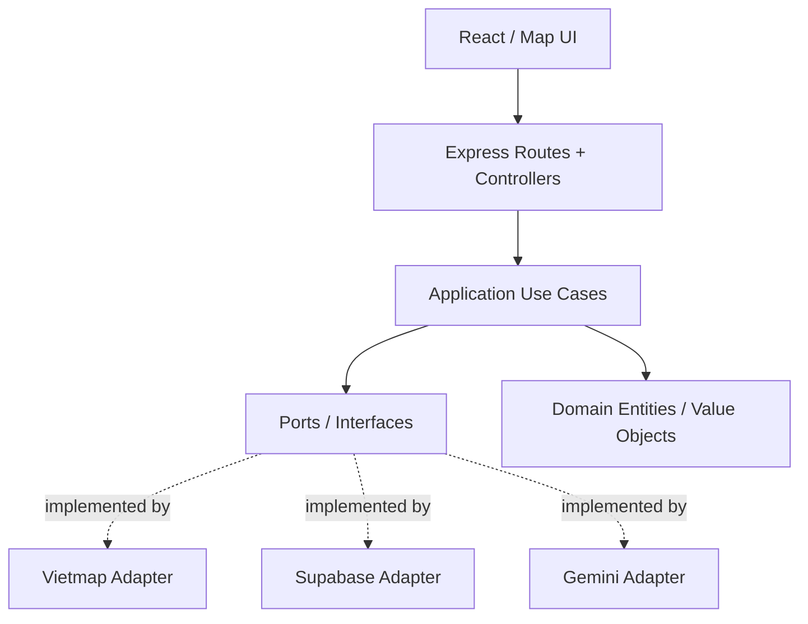

# Kiến trúc & quy tắc OOP

## Dependency Rule

`presentation -> application -> domain`

`infrastructure -> application ports + domain`

`composition-root -> mọi implementation`

Không import ngược chiều. `Controller` không viết SQL và không gọi trực tiếp Gemini/Vietmap. `UseCase` chỉ gọi interface. `Entity` giữ dữ liệu hợp lệ và phương thức nghiệp vụ.

## Patterns có chủ đích

- **Repository**: `TrafficReportRepository` → `InMemoryTrafficReportRepository` (demo), sau đó `SupabaseTrafficReportRepository`.
- **Adapter**: `PlaceSearchProvider` → `VietmapPlaceSearchProvider`; `AiVisionProvider` → `GeminiVisionProvider`.
- **Strategy**: `OptimizationStrategy` để thay `NearestNeighbor`/`TwoOpt`.
- **Dependency Injection bằng constructor**: `new CreateTrafficReportUseCase(repo)`; wiring tại `composition-root.ts`.
- **DTO + Zod**: đầu vào HTTP không phải domain entity.

## Hợp đồng module UI

N1 không truy cập DB traffic trực tiếp; N2 không sửa `MapView.tsx` trực tiếp. N2 cung cấp `useTrafficReports` và `TrafficReportPanel`; N1 render `TrafficMapLayer` qua interface chung.

## Ghi chú GPS và routing

- Dijkstra/A* là **thuật toán đồ thị riêng** trên OSM một khu vực giới hạn, khác kết quả route từ Vietmap.
- Vietmap Route/Matrix/TSP adapter ban đầu là `NotImplemented` cho tới khi tích hợp thật.
- Tối ưu ghé nhiều điểm với thời gian đi đường là bài toán TSP path/cycle tùy điểm đầu/cuối; ma trận có thể bất đối xứng.
- Không để kết quả từ một ảnh AI hoặc một report đơn lẻ mặc nhiên thành lệnh sửa mạng đường.
