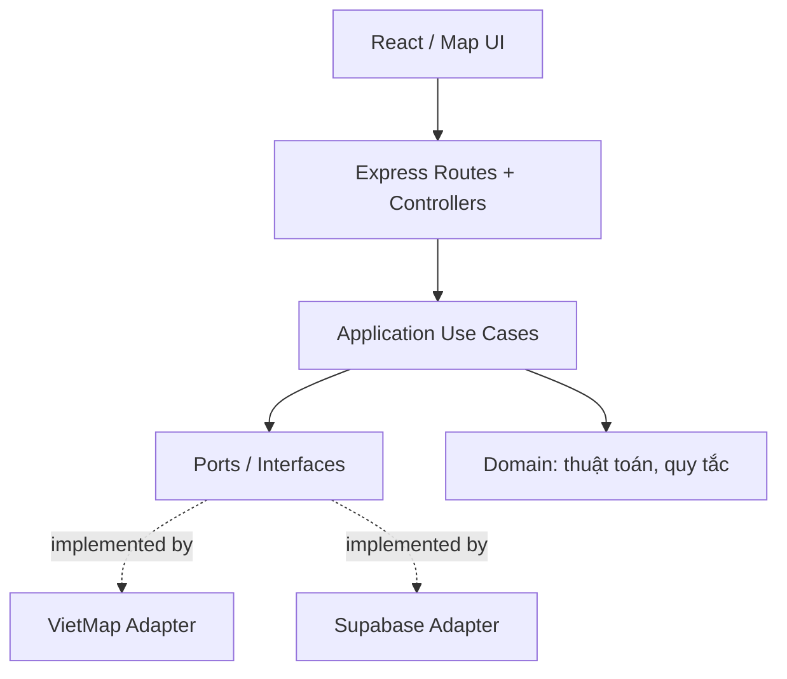

# Kiến trúc & quy tắc OOP

## Dependency Rule

Phụ thuộc chỉ đi **vào trong**; ESLint (`no-restricted-imports` trong `eslint.config.js`) chặn chiều ngược lại.

| Khối | Được import | Không được import |
| --- | --- | --- |
| API `modules/*/presentation` | application, domain, `shared` | infrastructure |
| API `modules/*/application` | domain, port của chính nó, `shared` | infrastructure, presentation, `express` |
| API `modules/*/domain` | `@routetwin/shared`, `shared` | application, infrastructure, presentation, `express` |
| API `modules/*/infrastructure` | port + domain để cài đặt | presentation |
| API `shared` | — | `modules` |
| API `composition-root.ts` | mọi implementation | — |
| Web `app` | features, `shared` | — |
| Web `features/*` | feature khác (kiểu, service), `shared` | `app` |
| Web `features/*/domain` | `shared/geo`, kiểu của feature | React, `components`, `hooks`, `api` |
| Web `shared` | — | `features`, `app` |

`Controller` không viết SQL và không gọi trực tiếp VietMap. `UseCase` chỉ gọi interface (port). Implementation cụ thể chỉ xuất hiện ở `composition-root.ts`.



## Chọn class hay hàm

- **Class** khi có trạng thái hoặc vòng đời (`RoutePath` tính sẵn đoạn, `NavigationGuidanceEngine`, `RequestGeneration`, `SignedUrlCache`), khi cài đặt một interface (adapter, repository, strategy) hoặc khi cần tiêm phụ thuộc qua constructor (use case, controller).
- **Hàm thuần** cho phép tính không trạng thái: hình học (`shared/geo`), định dạng (`shared/format`), chuyển đổi DTO (`placeFromPoi`, `toSavedRoute`).
- **Hook** chỉ nối class/hàm với React (state, effect); không chứa thuật toán.
- Không bọc dữ liệu không có hành vi vào class chỉ để "có OOP"; kiểu dữ liệu là `type`.

## Patterns có chủ đích

- **Repository**: `TrafficReportRepository` → `SupabaseTrafficReportRepository`; `SavedRouteRepository` → `LocalStorageSavedRouteRepository` (web).
- **Adapter**: `PlaceSearchProvider` → `VietmapPlaceSearchProvider`; `RouteProvider` → `VietmapRouteProvider`; `TrafficImageAnalyzer` → `GeminiTrafficImageAnalyzer`; `RouteComparisonSnapshots` → `SignedRouteComparison`; `FeatureQuota` → `SupabaseUserFeatureQuota`.
- **Strategy**: `OptimizationStrategy` (`ExactTourStrategy` Held–Karp / `TwoOptStrategy` NN + 2-opt); `ShortestPathSolver` (`DijkstraSolver` / `AStarSolver` trên khung `GraphSearchSolver`).
- **Dependency Injection bằng constructor**, wiring tại `composition-root.ts`.
- **DTO + Zod** (`packages/shared/src/schemas`): đầu vào HTTP được kiểm tra ở biên, không phải domain entity.

## Cấu trúc thư mục

```text
apps/api/src/
  app.ts                  # entry Vercel: export default createApp()
  create-app.ts           # factory Express (header, CORS, router, lỗi)
  main.ts                 # chạy local: createApp().listen()
  composition-root.ts     # nơi duy nhất biết implementation cụ thể
  config/                 # env đã kiểm tra bằng Zod
  modules/<feature>/
    domain/               # thuật toán, quy tắc thuần (+ port domain sở hữu)
    application/
      ports/              # interface I/O mà use case cần
      use-cases/
    infrastructure/       # adapter VietMap, Supabase, Gemini, OSM…
    presentation/         # controller + router Express
  shared/                 # http, errors, quota (port), supabase, geo, async
apps/web/src/
  app/
    App.tsx               # chỉ lắp ghép bản đồ, panel và các hook điều phối
    hooks/                # điều phối nhiều feature (dẫn đường + giao thông, POI, tuyến đã lưu…)
    components/ layout/   # khung ứng dụng, thanh trên, dock
    lazyPanels.ts types.ts
  features/<feature>/
    components/ hooks/ api/ services/
    domain/               # chỉ khi có nghiệp vụ độc lập UI (navigation)
    types.ts              # model mà feature sở hữu
  shared/
    ui/                   # SheetPanel, Popover, Icon, shell context
    geo/                  # types, distance, polyline: primitive hình học duy nhất
    format/ async/ api/ i18n/ hooks/ text/
packages/shared/src/schemas/   # DTO + validation dùng chung web/API
```

### Model thuộc về đâu (web)

| Kiểu | Chủ sở hữu |
| --- | --- |
| `LatLng`, `Coordinate`, `Bounds` | `shared/geo/types.ts` |
| `RoutePlan`, `RouteLeg`, `TransportMode`, `RouteObjective`, `AlgorithmOverlay` | `features/navigation/types.ts` |
| `MapLayer`, `DraftStops`, `MapOverlays` | `features/map/types.ts` |
| `Place`, `PlaceSource` | `features/places/types.ts` |
| `IncidentKind`, `DemoIncident`, `TrafficMapLayer` | `features/traffic/types.ts`, `features/traffic/services/trafficMapLayer.ts` |
| `FeatureKey` (panel đang mở) | `app/types.ts` |

## Phía web (`apps/web/src`)

| Tầng | Lớp / module | Vai trò |
| --- | --- | --- |
| Truyền tải | `HttpClient`, `ApiError`, `timeoutSignal` | Gọi HTTP duy nhất: bóc phong bì `{ data }`, timeout cả lúc đọc body, lỗi tiếng Việt |
| API client | `PlaceApiClient`, `TrafficApiClient`, `RouteApiClient`, … | Mỗi module backend một client, nhận `HttpClient` qua constructor |
| Lưu trữ | `SavedRouteRepository` ← `LocalStorageSavedRouteRepository`; `RecentPlacesRepository` | Ẩn nơi lưu; đổi cài đặt không sửa hook |
| Hình học | `shared/geo/distance.ts`, `shared/geo/polyline.ts` | Haversine, xấp xỉ phẳng, hướng, chiếu điểm lên đoạn/đường gấp khúc — mọi feature dùng chung |
| Miền dẫn đường | `RoutePath`, `NavigationGuidanceEngine`, `IncidentAheadDetector`, `SpeedEstimator` | Tiến độ, lệch tuyến, sự cố phía trước; có test, không biết React |
| Bất đồng bộ | `RequestSequence` (theo kênh), `RequestGeneration` (một luồng), `debounce`, `whenIdle` | Bỏ kết quả cũ về muộn, gom tải lại |
| Bản đồ | `LeafletMapController` | Adapter bọc Leaflet; React chỉ gọi method public |
| Điều phối | `app/hooks/use*` | Mỗi hook một luồng nghiệp vụ nhiều feature; `App.tsx` chỉ lắp ghép |

Quy tắc: component không gọi `fetch` hay `localStorage` trực tiếp; hook nhận lớp qua tham số (mặc định là bản dùng chung) để thay bằng bản giả khi test.

## Phía API (`apps/api/src`)

Mỗi module theo `presentation (Controller/Router) → application (UseCase + Port) → domain`, `infrastructure` cài đặt port.
Hạ tầng dùng chung ở `shared/http`: `SessionAuthenticator` (xác thực), `FeatureQuotaGuard` (hạn mức theo người dùng qua port `FeatureQuota`), `ConcurrencyLimiter` (giới hạn song song mỗi instance).
`npm run typecheck` kiểm tra cả mã chạy lẫn test (`tsconfig.test.json`).

## Hợp đồng module UI

N1 không truy cập DB traffic trực tiếp; N2 không sửa `MapView.tsx` trực tiếp. N2 cung cấp `useTrafficReports` và `TrafficReportPanel`; N1 render `TrafficMapLayer` (`features/traffic/services/trafficMapLayer.ts`) qua interface chung.

## Ghi chú GPS và routing

- Dijkstra/A* là **thuật toán đồ thị riêng** trên OSM một khu vực giới hạn (`/api/routes/pathfinding`), khác kết quả route từ VietMap; dùng ở chế độ thuyết trình để so sánh.
- VietMap Route v4 tính đường theo hình học và hướng dẫn rẽ; VietMap Matrix cấp ma trận chi phí cho tối ưu nhiều điểm.
- Tối ưu ghé nhiều điểm là bài toán TSP path/cycle tùy điểm đầu/cuối, ma trận có thể bất đối xứng: Held–Karp chính xác khi ít điểm, NN + 2-opt khi nhiều điểm (`algorithm: 'auto'`).
- Gemini có thể gợi ý loại/mức độ sự cố hoặc nội dung biển báo từ ảnh ngay trong form báo cáo. Tính năng mặc định tắt; người dùng phải xem lại và tự gửi, không tự xác nhận sự cố hay sửa tuyến.
